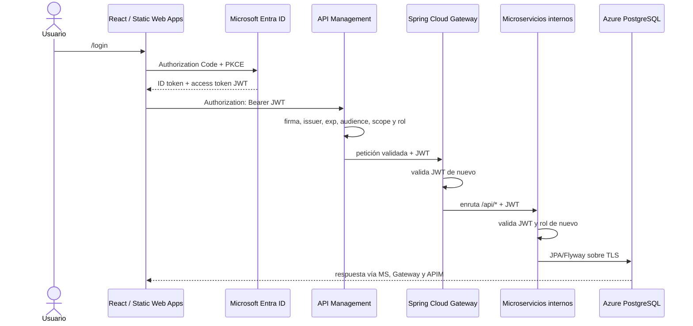

# Evaluación Azure — Municipalidad Valle del Sol

## Estado

El repositorio está preparado localmente para Azure. No se crearon recursos, no se publicaron imágenes y no se desplegó la aplicación. Todo elemento que requiere tenant, suscripción, dominio o token real continúa como acción manual.

## Arquitectura



Azure API Management es el borde administrado: publica la API, aplica CORS y políticas, valida JWT y produce evidencias 401/403. Spring Cloud Gateway es el router de aplicación desplegado como contenedor: conoce destinos internos y vuelve a validar el token. Los microservicios son Resource Servers finales; no se confía sólo en APIM.

## Servicios Azure preparados

- Resource Group; ACR Basic; Container Apps Environment y cuatro Container Apps.
- API Management Consumption por defecto; Static Web Apps Free.
- PostgreSQL Flexible Server Burstable B1ms, 32 GB, sin HA ni geo-backup.
- Log Analytics, Application Insights, Key Vault y Managed Identity.
- RBAC: identidad con `AcrPull` y `Key Vault Secrets User`.

Los SKUs generan costos o cuotas: APIM Consumption cobra por llamadas; ACR Basic, PostgreSQL, Log Analytics y Application Insights pueden cobrar aunque el uso sea bajo. Container Apps puede entrar en cuota gratuita, pero no se garantiza. Consulta la calculadora y límites vigentes de Azure for Students antes de desplegar.

## OAuth/OIDC y autorización

La guía manual está en `docs/ENTRA_ID.md`. React usa MSAL redirect, PKCE y `acquireTokenSilent`; no hay client secret ni persistencia manual del access token. Los claims `scp` se convierten a `SCOPE_*` y `roles` a `ROLE_*`.

| Operación | Permiso |
|---|---|
| GET perfil, reportes, mapa, notificaciones | `api.access`, usuario autenticado |
| POST crear reporte | USER, STAFF, EMERGENCY_ENTITY o ADMIN |
| PUT estado/reporte | STAFF, EMERGENCY_ENTITY o ADMIN |
| DELETE reporte | ADMIN |
| POST notificación | STAFF, EMERGENCY_ENTITY o ADMIN |

Un token ausente, malformado, expirado, de otro issuer/audience o sin scope recibe 401 en APIM. Un token criptográficamente válido que llega a una operación sin el rol requerido recibe 403. Spring repite ambas defensas.

## Endpoints públicos de APIM

- `GET /api/me`
- `GET /api/reportes` y `/api/reportes/sincronizar`
- `POST /api/reportes/crear`
- `PUT /api/reportes/editar/{id}`
- `DELETE /api/reportes/eliminar/{id}`
- `GET /api/mapa/sincronizar`
- `GET /api/notificaciones/historial`
- `POST /api/notificaciones/enviar?canal=SMS|EMAIL`

La especificación está en `infra/apim/openapi.yaml`; las políticas y Named Values están en `infra/apim/`.

## Variables

Frontend: `VITE_ENTRA_CLIENT_ID`, `VITE_ENTRA_TENANT_ID`, `VITE_ENTRA_AUTHORITY`, `VITE_ENTRA_REDIRECT_URI`, `VITE_ENTRA_POST_LOGOUT_REDIRECT_URI`, `VITE_ENTRA_SIGN_UP_URL`, `VITE_API_SCOPE` (`api://<API_CLIENT_ID>/api.access`) y `VITE_API_URL` (origen HTTPS de APIM sin ruta).

Backend: `AZURE_TENANT_ID`, `AZURE_CLIENT_ID` (reservado para integración/telemetría), `AZURE_API_AUDIENCE` (GUID del client ID de la API, sin `api://`), `SPRING_SECURITY_OAUTH2_RESOURCESERVER_JWT_ISSUER_URI`, opcional `SPRING_SECURITY_OAUTH2_RESOURCESERVER_JWT_JWK_SET_URI`, `DB_HOST`, `DB_PORT`, `DB_NAME`, `DB_USERNAME`, `DB_PASSWORD`, `DB_SSL_MODE`, `CORS_ALLOWED_ORIGINS` y las tres `MS_*_URL`.

## Ejecución local

1. Copia `backend/.env.example` a `backend/.env` y `frontend/.env.example` a `frontend/.env`.
2. Sustituye placeholders con IDs reales. Para Docker configura también JWK Set URI; no uses secretos en el frontend.
3. Ejecuta `cd backend; docker compose up --build`.
4. Ejecuta `cd frontend; npm ci; npm run dev`.
5. Abre `http://localhost:5173`; el frontend sólo llama `http://localhost:8080`. En producción el build falla si `VITE_API_URL` falta, apunta a localhost o contiene una ruta.

Los perfiles son `local` (Compose), `test`/configuración H2 bajo `src/test/resources`, y `prod` (Container Apps). Producción usa `ddl-auto=validate`; Flyway crea tablas.

## Pruebas

```powershell
cd frontend
npm ci
npm run lint
npm test
npm run build
cd ../backend
./mvnw.cmd clean test
./mvnw.cmd clean package
docker compose --env-file .env config
docker compose --env-file .env up --build
```

Smoke Azure:

```powershell
$env:ACCESS_TOKEN='<token-valido>'
$env:TOKEN_WITHOUT_ROLE='<token-sin-rol>'
$env:ADMIN_TOKEN='<token-admin>'
./scripts/smoke-test.ps1 -ApimUrl 'https://<APIM>.azure-api.net'
```

Linux/macOS: `APIM_URL=... ACCESS_TOKEN=... TOKEN_WITHOUT_ROLE=... ./scripts/smoke-test.sh`. Los scripts nunca escriben tokens.

## Despliegue Azure (no ejecutar sin autorización)

1. Instala Azure CLI y Bicep; autentica: `az login` y selecciona suscripción con `az account set --subscription <ID>`.
2. Revisa nombres, región, SKUs, costos y `infra/main.parameters.example.json`. Usa un Key Vault bootstrap o parámetro seguro para PostgreSQL.
3. Valida sin desplegar:

   `az deployment sub validate --location eastus2 --template-file infra/main.bicep --parameters @infra/main.parameters.json`

4. Con autorización explícita, despliega:

   `az deployment sub create --location eastus2 --template-file infra/main.bicep --parameters @infra/main.parameters.json`

5. Construye/publica imágenes con `.github/workflows/container-images.yml` o ACR; usa tags inmutables. Ejecuta manualmente `deploy-container-apps.yml`.
6. Importa OpenAPI y aplica políticas siguiendo `infra/apim/README.md`; reemplaza los Named Values y elimina localhost de CORS productivo.
7. Configura Entra y las URIs SPA; carga variables GitHub/Static Web Apps y ejecuta manualmente `deploy-static-web-app.yml`.
8. Ejecuta Postman y smoke tests; captura las evidencias.

El Bicep deja los microservicios con ingress interno y gateway externo para APIM. Para aislamiento de red estricto en una entrega posterior, usa APIM con VNet compatible y un Container Apps Environment integrado a VNet; esto puede elevar notablemente el costo.

## Observabilidad

Todos los servicios exponen `/actuator/health`, Docker/Container Apps usan health probes y las respuestas propagan `X-Correlation-ID`. Los logs incluyen correlation ID pero nunca el JWT. Bicep crea Log Analytics y Application Insights y entrega su connection string; para telemetría Java completa falta adjuntar/configurar el agente Application Insights en las imágenes.

## Eliminación tras la evaluación

Verifica dos veces el nombre y luego elimina únicamente el Resource Group dedicado:

`az group delete --name rg-valle-sol-<SUFFIX> --yes --no-wait`

La operación es irreversible. Confirma antes que no haya recursos compartidos, exporta evidencias y elimina también credenciales federadas/secrets de CI que ya no se usen.

## Checklist de capturas

- [ ] Tenant Entra y usuarios registrados.
- [ ] Dos app registrations, scope `api.access`, roles y asignaciones.
- [ ] Inicio de sesión y JWT redactado.
- [ ] APIM, API/operaciones y políticas JWT/roles.
- [ ] Sin token 401; inválido 401; válido sin rol 403; autorizado 200.
- [ ] Static Web App y cuatro Container Apps activos.
- [ ] Frontend mostrando datos cuyo host de Network sea APIM.
- [ ] Health, logs/métricas y correlation ID.
- [ ] Resource Group con todos los recursos.

## Checklist de rúbrica

| Criterio | Estado |
|---|---|
| MSAL/PKCE, ruta privada, Bearer Axios, roles UI | Cumplido localmente |
| Gateway y microservicios validan issuer/audience/firma/exp/scope/roles | Cumplido localmente |
| PostgreSQL, perfiles, Flyway, Compose y Docker multi-stage | Cumplido y verificado localmente con los cinco contenedores saludables |
| Tests automáticos 401/403/200/rol/CORS/CRUD base | Cumplido localmente |
| APIM OpenAPI, CORS, validate-jwt y políticas 403 | Preparado; importación manual pendiente |
| Bicep Azure y CI/CD OIDC | Preparado; validación CLI/despliegue manual pendientes |
| APIM/Entra/usuarios/recursos creados y funcionando | Requiere acción manual y autorización |
| Comunicación SPA → APIM → gateway → microservicio en Azure | Requiere despliegue y smoke test real |
| Wallet eliminado del árbol de trabajo | Cumplido; historial Git y rotación de secretos requieren acción manual urgente |

## Problemas conocidos

- Esta carpeta no es un repositorio Git independiente; Git descubre `C:\Users\matia` y no se pudo auditar el índice/historial. Inicializa/mueve a un repositorio de alcance seguro antes de publicar.
- El wallet Oracle fue eliminado físicamente del árbol de trabajo. Como no se pudo auditar el repositorio Git superior, aún debe retirarse de cualquier índice/historial y deben rotarse sus credenciales y certificados.
- La gestión visual de usuarios conserva la interfaz, pero sus mutaciones devuelven una explicación: deben hacerse en Entra o en una API confidencial Microsoft Graph.
- El bundle frontend supera 500 kB; funciona, pero conviene dividir dashboards con `React.lazy`.
- No se validó Bicep porque Azure CLI no está instalado en este equipo.
- No se probó el flujo Azure ni costos reales porque faltan tenant, suscripción, dominios e autorización de despliegue.
