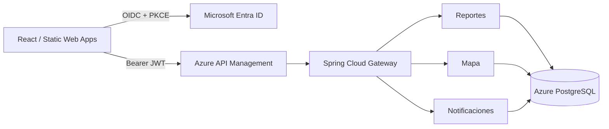

# Plataforma de Emergencias Valle del Sol

Solución Cloud Native para Microsoft Azure: React 19 + MSAL, Azure API Management, Spring Cloud Gateway, tres microservicios Spring Boot 4/Java 21 y PostgreSQL.



## Inicio rápido local

Requisitos: Java 21, Node 22+, Docker Desktop y un tenant/app registrations de Entra configurados.

```powershell
Copy-Item backend/.env.example backend/.env
Copy-Item frontend/.env.example frontend/.env
# Completar ambos .env con IDs reales; nunca confirmar esos archivos.
Set-Location backend
docker compose up --build
```

En otra terminal: `cd frontend`, `npm ci`, `npm run dev`.

Verificaciones: `npm run lint`, `npm test`, `npm run build`, `./mvnw.cmd clean test` y `./mvnw.cmd clean package` desde sus carpetas correspondientes.

La guía completa está en [EVALUACION_AZURE.md](EVALUACION_AZURE.md), Entra en [docs/ENTRA_ID.md](docs/ENTRA_ID.md) y APIM en [infra/apim/README.md](infra/apim/README.md).

## Seguridad urgente

El wallet y credenciales Oracle encontrados deben considerarse expuestos: los archivos ya fueron eliminados del árbol de trabajo, pero aún debes rotar la contraseña Oracle, revocar/reemitir certificados y eliminarlos del índice e historial Git con revisión humana. `.gitignore` no limpia commits anteriores. No publiques el repositorio antes de un escaneo de secretos e historial.

No se ha creado ni desplegado ningún recurso Azure.
